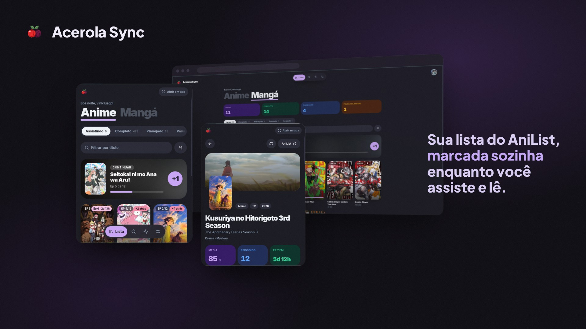
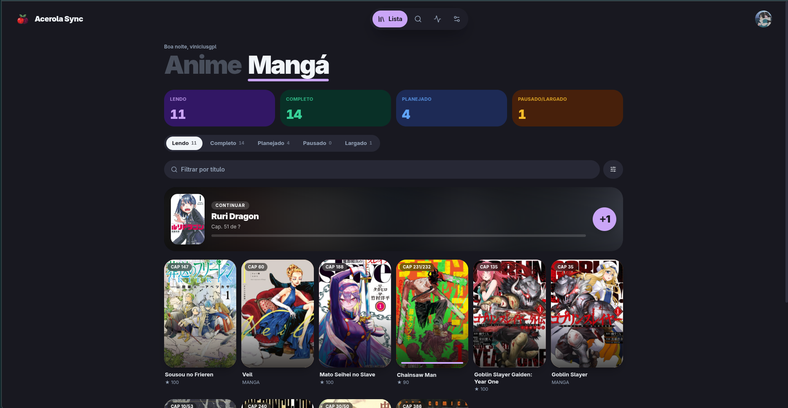
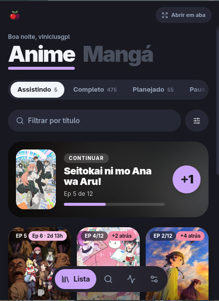
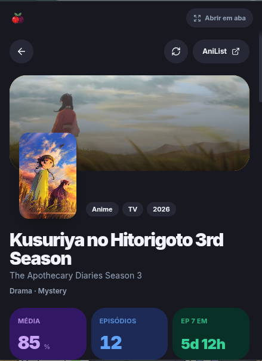
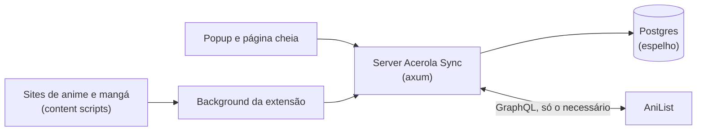

# Acerola Sync

<p align="center">
  
</p>

Sua lista do AniList espelhada num servidor seu e marcada sozinha enquanto você assiste e lê. Uma extensão de navegador reconhece o episódio ou capítulo aberto (Sakura Mangás, MangaDex, Crunchyroll, Netflix e qualquer site que você cadastrar pela URL) e um server em Rust mantém tudo sincronizado com o AniList, anime e mangá.

Inspirado no MALSync, mas só com AniList e para uso pessoal: uma instância, um usuário.

## Galeria

<table>
  <tr>
    <td colspan="2" align="center">
      <br>
      <sub><b>Página cheia</b> — a lista com os números do tipo e as fichas por status</sub>
    </td>
  </tr>
  <tr>
    <td align="center">
      <br>
      <sub><b>Popup</b> — continuar de onde parou, +1 e filtros</sub>
    </td>
    <td align="center">
      <br>
      <sub><b>Obra</b> — ficha, próximo episódio, onde assistir e sync só dela</sub>
    </td>
  </tr>
</table>

## O que tem

- **Lista espelhada**: as telas leem do Postgres do server, não do AniList. Sync incremental (só o que mudou, quase sempre 1 request), lista inteira no intervalo que você escolher, manual ou em horários agendados.
- **Escrita dupla**: cada mudança vai para o AniList e para o espelho na mesma hora. Com o AniList fora do ar, fica pendente e é reenviada depois.
- **Rastreio nos sites**: marca o capítulo depois de alguns segundos na página e o episódio quando o vídeo passa de 85%. Botão fixo da acerola no canto da página e aviso com a obra.
- **Sites personalizados**: qualquer site, por uma regex da URL, com busca e seletor de título. Quando o número do capítulo não está na URL, o modo avançado lê do título da página ou de um elemento (seletor CSS + regex) e testa numa aba aberta antes de salvar.
- **Filtros no server**: título, ordenação, situação, formato, ano e gênero.
- **Aviso de episódio novo**: notificação do sistema quando sai episódio de um anime que você está vendo (clicar abre a obra) e o número de obras com episódio novo no ícone da extensão.
- **Ficha da obra**: informações, relacionadas, links e "onde assistir/ler" (continuar na última página marcada, streaming oficial e busca nos sites).

## Pastas

| Pasta | O que é | Stack | Leia mais |
| --- | --- | --- | --- |
| [`acerola-sync/server/`](acerola-sync/server/README.md) | API e espelho do AniList | Rust + axum + sqlx + Postgres | [server/README.md](acerola-sync/server/README.md) |
| [`acerola-sync/extension/`](acerola-sync/extension/README.md) | Extensão de navegador (Chrome e Firefox) | WXT + Svelte 5 + Tailwind v4 + GSAP | [extension/README.md](acerola-sync/extension/README.md) |
| [`acerola-sync/server/.config/docker/`](acerola-sync/server/.config/docker/) | Imagem e compose do server | Docker | [docs/ARQUITETURA.md](docs/ARQUITETURA.md) |
| [`acerola-sync/server/.config/ansible/`](acerola-sync/server/.config/ansible/) | Deploy do server num VPS | Ansible + Caddy | [Release e deploy](#release-e-deploy) |

## Como as peças se conectam



O content script nunca fala com o server direto: pede ao background, que tem a sessão. As telas leem do espelho; o AniList só é chamado para escrever, para o sync e para a ficha completa de uma obra (uma vez por obra).

## Rodando

Com o [mise](https://mise.jdx.dev) instalado, dentro de `acerola-sync/`:

```bash
mise run build             # server (docker) + extensão
mise run build:server      # só o server: rebuilda a imagem e sobe o container
mise run build:extension   # só a extensão (extension/.output/chrome-mv3)
```

O `build:extension` lê a chave da extensão no 1Password (`op signin` antes) para sair com o id fixo. O server lê `acerola-sync/server/.env` (modelo em `.env.example`: Postgres, chave de criptografia e Client ID do AniList). A extensão carrega em `chrome://extensions` → modo desenvolvedor → "Carregar sem compactação" → `extension/.output/chrome-mv3`.

## Release e deploy

Tags no mesmo molde do acerola-reader: `<app>/<canal>/v<versão>`, canal `alpha`, `beta` ou `prod`.

| Tag | O que acontece |
| --- | --- |
| `extension/prod/v1.2.0` | Sobe a versão, testa, gera os `.zip` de Chrome e Firefox e publica o Release. |
| `server/prod/v1.2.0` | Sobe a versão (commit de bump) e dispara o deploy. |

O deploy usa o Ansible em [`acerola-sync/server/.config/ansible/`](acerola-sync/server/.config/ansible/): rsync do código, `.env` gerado, `docker compose up` e a config do Caddy para o domínio do `hosts.ini`. Roda sozinho na tag `server/prod/*`, pelo botão do workflow **Deploy/Server** ou local com `mise run deploy`. Detalhes em [docs/ARQUITETURA.md](docs/ARQUITETURA.md#release-e-deploy) e o modelo de notas em [RELEASE.md](RELEASE.md).

## Documentação

- Arquitetura e decisões: [docs/ARQUITETURA.md](docs/ARQUITETURA.md)
- Extensão (contextos, permissões, uso pessoal sem loja): [docs/EXTENSAO.md](docs/EXTENSAO.md)
- Padrão de design: [`.claude/skills/acerola-design/SKILL.md`](.claude/skills/acerola-design/SKILL.md)
- Regras do projeto e de commit: [CLAUDE.md](CLAUDE.md) e [`.gitmessage`](.gitmessage)
- Assets dos READMEs: [`docs/github/`](docs/github/) (a capa é gerada de `docs/github/source/hero.html`)
- Licença: [LICENSE](LICENSE) (MPL-2.0, a mesma do acerola-reader)
