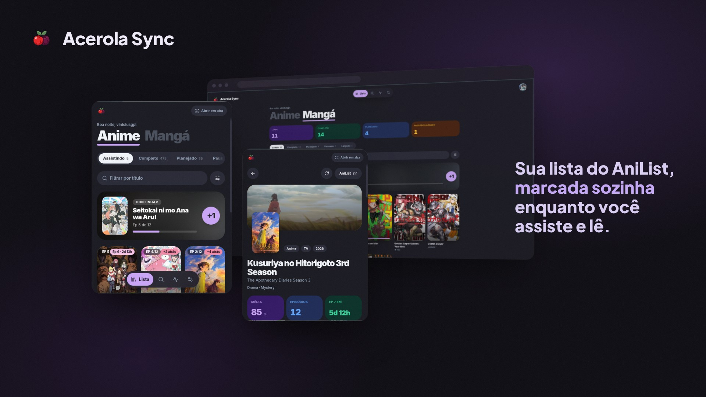
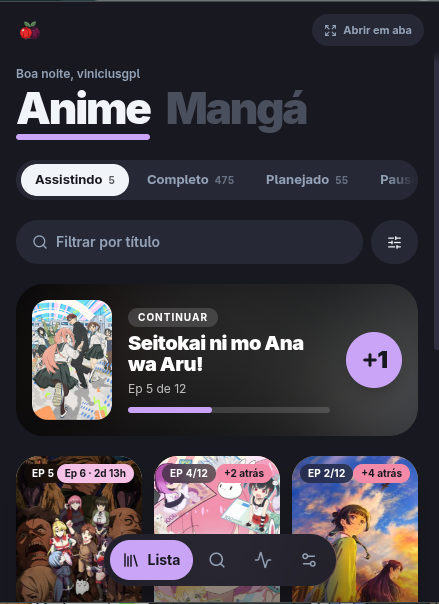
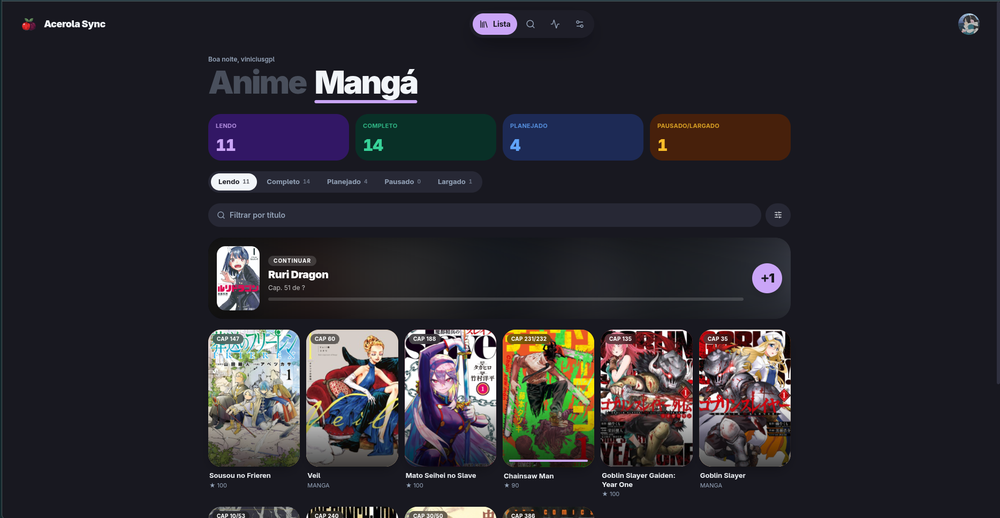
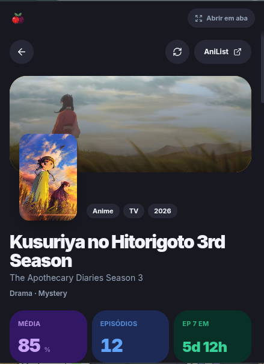

# acerola-sync-extension

Extensão de navegador do **Acerola Sync** (Chrome e Firefox, Manifest V3). Mostra a sua lista do AniList espelhada no server, reconhece o episódio ou capítulo aberto nos sites e marca sozinha.

---

## Preview

<p align="center">
  
</p>

---

## Galeria

<table>
  <tr>
    <td rowspan="2" valign="top" align="center">
      <br>
      <sub><b>Popup — lista</b></sub>
    </td>
    <td align="center">
      <br>
      <sub><b>Página cheia</b></sub>
    </td>
  </tr>
  <tr>
    <td align="center">
      <br>
      <sub><b>Obra</b></sub>
    </td>
  </tr>
</table>

---

## Telas

| Tela        | O que faz                                                                                                                                                                                        |
| ----------- | ------------------------------------------------------------------------------------------------------------------------------------------------------------------------------------------------ |
| **Lista**   | Anime e Mangá, fichas por status com contagem, filtros (título, ordenação, situação, formato, ano, gênero), "continuar" com +1 e rolagem infinita. No popup, o topo mostra a obra da aba aberta. |
| **Obra**    | Ficha completa, progresso, nota, status, sync só dela, onde assistir/ler e relacionadas.                                                                                                         |
| **Busca**   | Primeiro no espelho; se não achar, no AniList.                                                                                                                                                   |
| **Sync**    | Estado, logs ao vivo, horários agendados e intervalo da lista inteira. Histórico do que foi marcado.                                                                                             |
| **Ajustes** | Tema, sites embutidos, tempo do capítulo e sites personalizados.                                                                                                                                 |

## Sites

| Site          | Tipo    | Marca quando                                      |
| ------------- | ------- | ------------------------------------------------- |
| Sakura Mangás | Mangá   | alguns segundos na página do capítulo             |
| MangaDex      | Mangá   | alguns segundos na página do capítulo             |
| Crunchyroll   | Anime   | o vídeo passa de 85%                              |
| Netflix       | Anime   | o vídeo passa de 85% (só obras da lista)          |
| Personalizado | os dois | pela regex da URL (`(?<id>…)` e `(?<progress>…)`) |

## Rodando

```bash
npm install            # na raiz do workspace (acerola-sync/)
npm run dev -w extension
npm run build -w extension     # .output/chrome-mv3
npm run zip -w extension       # .zip do Chrome (zip:firefox para o Firefox)
```

## Testes

```bash
npm test -w extension          # unitários (Vitest + jsdom)
npx playwright test            # e2e e visuais (Chromium sem janela), dentro de extension/
npm run lint:design            # padrão de design (na raiz do workspace)
```

Os testes visuais (`tests/e2e/visual.spec.ts`) medem o layout de verdade: pílula alinhada à ficha, troca Anime ↔ Mangá sem pulo, diálogos sem borda. Os screenshots ficam em `test-results/visual/`.

## Estrutura

- `svelte/src/entrypoints/` — background, popup, página cheia e content scripts.
- `svelte/src/lib/screens/` — telas.
- `svelte/src/lib/components/` — componentes (`.svelte` + `.test.ts` + `.stories.svelte`).
- `svelte/src/lib/tracking/` — adapters dos sites, runner e aviso na página.
- `svelte/src/theme/` — cores (cópia do acerola-reader) e tokens de forma.

Mais em [docs/EXTENSAO.md](../../docs/EXTENSAO.md).
