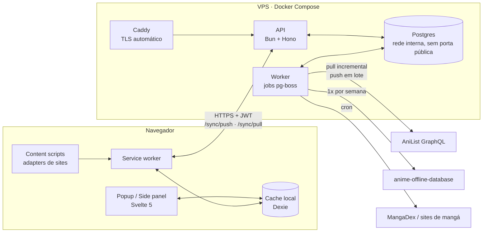
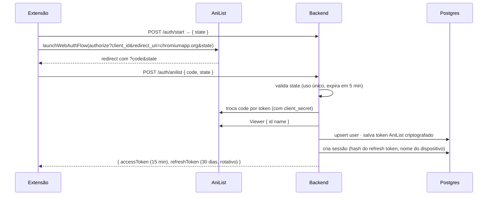
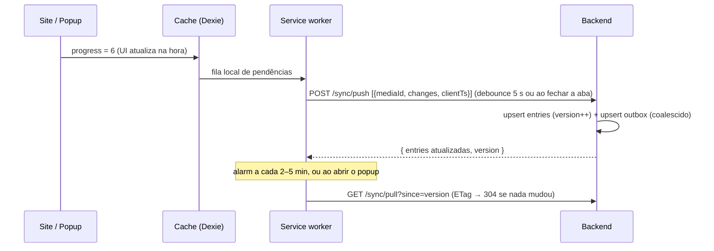

# Acerola Sync — Arquitetura

> Extensão (Chrome/Firefox) + backend próprio para tracking de anime e mangá, com sync atrasado e econômico com o AniList.
> Licença: MIT. Uso pessoal primeiro, mas qualquer pessoa pode hospedar a própria instância.

## 1. Princípios

1. **O backend é obrigatório e é a fonte da verdade.** O banco (Postgres) fica no servidor.
2. **A extensão nunca acessa o banco.** Ela fala só com a API do backend, via HTTPS e token de sessão, e não carrega nenhum segredo dentro do pacote.
3. **Só o backend fala com o AniList.** Ele guarda o token do AniList criptografado, centraliza o rate limit e envia as mudanças em lote, com atraso.
4. **A extensão tem um cache local** (IndexedDB) apenas para a UI ser instantânea e funcionar offline. Esse cache é descartável.
5. **Dados estáticos não vêm do AniList.** Títulos, IDs cruzados e episódios vêm de um dataset offline importado no Postgres.

## 2. Visão geral



## 3. Segurança

### 3.1 Onde fica cada segredo
| Segredo | Onde fica | Nunca fica em |
|---|---|---|
| Credenciais do Postgres | `.env` do servidor (só o container da API/worker lê) | extensão, repositório git |
| `ANILIST_CLIENT_SECRET` | `.env` do servidor | extensão |
| Token do AniList do usuário | Postgres, **criptografado** com AES-256-GCM (chave em `ENCRYPTION_KEY` no `.env`) | extensão, logs |
| Refresh token da sessão | extensão: `chrome.storage.local`. Servidor: só o **hash** SHA-256 | `chrome.storage.sync`, logs |
| Access token (JWT) | só na memória do service worker, curto (15 min) | disco |

### 3.2 Login (OAuth do AniList passando pelo backend)



- O `client_secret` nunca sai do servidor. A extensão só repassa o `code`.
- **Refresh rotativo:** cada `/auth/refresh` invalida o refresh token anterior. Se um token antigo for reutilizado, todas as sessões daquele dispositivo são revogadas (detecção de roubo).
- **Logout e revogação:** `DELETE /auth/session/:id`, com uma lista de dispositivos na tela de opções.
- **Uso só pessoal:** dá para travar a instância com `ALLOWED_ANILIST_IDS=123456` no `.env`, e ninguém mais consegue logar.

### 3.3 Proteções do servidor
- **Postgres** só na rede interna do Docker, **sem porta exposta**. A API usa um usuário com permissões mínimas, sem ser superusuário e sem DDL; as migrações rodam com outro usuário.
- **HTTPS obrigatório** via Caddy, com HSTS.
- **Validação** de todo input com Valibot. Queries só pelo Drizzle (parametrizadas, sem SQL concatenado).
- **Rate limit por usuário e por IP** na API (ex.: 120 req/min), separado do rate limit do AniList.
- **CORS** restrito a `chrome-extension://<id>`. Isso não substitui a autenticação: quem protege é o JWT, porque o ID da extensão no Firefox varia por instalação.
- **Logs** sem tokens nem bodies sensíveis.
- **Backup diário** com `pg_dump` criptografado, enviado para fora do VPS.
- **Dependências:** lockfile, `pnpm audit` no CI e Renovate.

## 4. Monorepo

```
acerola-sync/
├─ packages/
│  ├─ core/        # TS puro: tipos, schemas Valibot, regras de merge, mapping
│  └─ api-client/  # cliente tipado da API (usado pela extensão)
├─ apps/
│  ├─ extension/   # WXT + Svelte 5 + Dexie (cache)
│  │  ├─ entrypoints/   # background.ts, popup/, sidepanel/, options/, content/*.ts
│  │  └─ sites/         # adapters (defineSite)
│  └─ server/      # Bun + Hono + Drizzle + pg-boss
│     ├─ routes/        # auth, sync, airing, search, manga
│     ├─ jobs/          # anilist-push, anilist-pull, airing, notifications, dataset, manga
│     ├─ anilist/       # cliente GraphQL + token bucket
│     └─ db/            # schema Drizzle + migrações
├─ docker-compose.yml  # caddy, api, worker, postgres
├─ .env.example
└─ docs/
```

A API e o worker são o **mesmo código** com entrypoints diferentes (`server.ts` e `worker.ts`), em containers separados.

## 5. Banco (Postgres)

| Tabela | Chave | Conteúdo |
|---|---|---|
| `users` | `id` | `anilist_user_id`, nome, avatar, configurações (jsonb) |
| `anilist_tokens` | `user_id` | `ciphertext`, `iv`, `tag`, `expires_at` |
| `sessions` | `id` | `user_id`, `refresh_hash`, `device`, `last_used_at`, `expires_at`, `revoked_at` |
| `media` | `id` (AniList) | `mal_id`, `kitsu_id`, títulos/sinônimos (jsonb), formato, episódios, capítulos, status, capa, `next_airing_at`, `fetched_at` (**compartilhada entre usuários**) |
| `entries` | `(user_id, media_id)` | status, progress, score, datas, notas, `updated_at`, `remote_updated_at`, **`version`** (bigint de uma sequence global) |
| `outbox` | `(user_id, media_id)` | `changes` (jsonb coalescido), `first_change_at`, `last_change_at`, `priority`, `attempts`, `next_try_at` |
| `airing` | `(media_id, episode)` | `airing_at` |
| `site_map` | `(site, slug)` | `media_id`, `user_id` (null = global, preenchido = correção pessoal) |
| `history` | `id` | `user_id`, `media_id`, unidade (ep/cap), site, `watched_at` |
| `sync_state` | `user_id` | `last_pull_at`, `last_push_at`, `last_notification_count` |

**Por que `version`:** toda escrita em `entries` recebe um novo valor da sequence. A extensão pede `GET /sync/pull?since=<version>` e recebe só o que mudou, o que é barato e serve para vários dispositivos ao mesmo tempo.

**Dataset offline:** o job `dataset` baixa o anime-offline-database toda semana e faz upsert em `media` e `site_map`. Os dados são ODbL (pedem atribuição); o código continua MIT.

## 6. Fluxo de sync

### 6.1 Extensão ↔ backend (barato, é o seu servidor)



- A fila local da extensão serve só para o caso de ficar **offline**. Quando a rede volta, ela é enviada e esvaziada.
- O merge com o que já está no banco usa as regras do `core` (seção 6.3).

### 6.2 Backend ↔ AniList (o que precisa ser econômico)

O job `anilist-push` (pg-boss) roda a cada minuto e pega da `outbox` os itens que estão prontos:

| Regra | Padrão |
|---|---|
| Debounce: sem mudança nova há X min | 10 min |
| Teto: o item mais antigo esperando | 60 min |
| Mudança importante (status, score) | 2 min |
| "Sincronizar agora" (`POST /sync/flush`) | imediato |

Para cada usuário com itens prontos:
1. **Pull incremental antes** (`Page.mediaList(userId, sort: UPDATED_TIME_DESC)` até `updatedAt <= last_pull_at`), que normalmente custa 1 request.
2. **Merge** dos conflitos (6.3).
3. **Push em lote:** 1 mutation com até ~20 `SaveMediaListEntry` em aliases, que conta como 1 request. *(A validar; se o AniList não aceitar, cai para 1 mutation por mídia.)*
4. Remove da outbox o que foi enviado. Se falhar, aplica `attempts++` e `next_try_at` com backoff.

**Outros jobs:**
| Job | Query | Frequência | Custo |
|---|---|---|---|
| `anilist-pull` | incremental (captura edições feitas no site do AniList) | 15 min | ~1 req/usuário |
| `airing` | `Page.airingSchedule(mediaId_in: [RELEASING da lista], próximos 7 dias)` | 1x/dia | 1 req/usuário |
| `notifications` | `Viewer { unreadNotificationCount }`, e a lista só se o número mudou | 30 min (opcional) | 1 req |
| `media-refresh` | `Page.media(id_in: [...50])` só para mídias sem dados ou vencidas (TTL de 30 dias para FINISHED, 1 dia para RELEASING) | 1x/dia | 0–2 req |
| `dataset` | anime-offline-database (GitHub) | 1x/semana | 0 no AniList |
| `manga` | MangaDex `/manga/{id}/feed` + adapters de servidor | 1–2 h por fonte | 0 no AniList |

**Rate limit do AniList (`server/anilist`):** um token bucket global de **20 req/min** (o AniList permite ~90 e às vezes reduz para 30). Lê `X-RateLimit-Remaining` e `Retry-After`; em 429 pausa tudo com backoff e jitter. Prioridade: push > pull > airing > notificações > metadados.

**Orçamento estimado (1 usuário pesado):** cerca de 140 req/dia, contra um limite de ~90 por minuto.

### 6.3 Regras de merge (no `core`)
- `progress`: vale o maior, a menos que a mudança local seja marcada como `force` (o usuário voltou o episódio manualmente).
- `status`: vale o mais recente, mas um adapter nunca rebaixa COMPLETED.
- `score` e `notes`: vale o mais recente (last-write-wins pelo timestamp).
- Se o remoto mudou e não há nada local pendente: aplica o remoto em `entries` (`version++`) e não envia nada.

## 7. API (resumo)

| Método | Rota | Descrição |
|---|---|---|
| POST | `/auth/start` | gera o `state` |
| POST | `/auth/anilist` | troca o `code` e cria a sessão |
| POST | `/auth/refresh` | rotaciona o refresh token |
| GET/DELETE | `/auth/sessions` | lista e revoga dispositivos |
| GET | `/sync/pull?since=` | entries alteradas (ETag) |
| POST | `/sync/push` | mudanças do cliente |
| POST | `/sync/flush` | força o envio ao AniList |
| GET | `/airing?from=&to=` | agenda |
| GET | `/search?q=` | busca primeiro em `media` (pg_trgm) e só depois no AniList |
| POST | `/resolve` | `{site, slug, title}` → `mediaId` (mapping) |
| GET | `/manga/updates?since=` | capítulos novos |

A busca usa a extensão **pg_trgm** do Postgres para fazer fuzzy search de títulos direto no banco, sem gastar request no AniList.

## 8. Deploy

`docker-compose.yml`:
- `caddy`: portas 80/443, TLS automático, proxy para a `api`
- `api`: Bun + Hono, sem porta pública
- `worker`: mesmo código, roda os jobs
- `postgres`: volume persistente, **sem `ports:`**, rede interna
- `backup`: cron com `pg_dump` + `age` (criptografia), enviando para um storage externo

**Hospedagem:** um VPS pequeno (1 vCPU, 1–2 GB de RAM) dá conta, por cerca de US$ 4–6/mês (Hetzner, Oracle Free Tier etc.). Domínio próprio ou subdomínio grátis (DuckDNS) com o Caddy.

## 9. Roadmap

| Fase | Entrega | Estimativa |
|---|---|---|
| **0** | Monorepo, docker-compose, Postgres + Drizzle, login AniList, sessões/refresh, extensão WXT + Svelte fazendo login | 25–40 h |
| **1** | `entries` + `outbox`, pull/push com o AniList, `/sync/*`, lista com +1 no side panel, agenda, notificações | 50–90 h |
| **2** | Dataset offline, `/resolve` com pg_trgm, 3–5 adapters, histórico | 80–200 h |
| **3** | Mangá (MangaDex + scrapers no worker) | 40–80 h |
| **4** | MAL/Kitsu como destinos extras de sync | 30–60 h |

## 10. Decisões em aberto
- [ ] VPS: qual provedor e qual domínio?
- [ ] Debounce/teto (10/60 min): ajustar com uso real.
- [ ] Confirmar se o AniList aceita mutations em lote com aliases.
- [ ] Atualizações em tempo real para a extensão: polling a cada 2–5 min (simples, recomendado) ou SSE (o service worker do MV3 morre e derruba a conexão).
